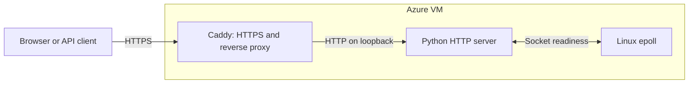

# C10K Server

**One Python process. Ten thousand simultaneous connections.**

An HTTP/1.1 server built from scratch with Python sockets and Linux event notifications. It handles connections, parses requests, and sends responses without Flask, FastAPI, Django, or another web framework.

The project also includes a browser dashboard, an interactive API playground, automated tests, and an Azure deployment using Docker and Caddy for HTTPS.

**[Open the demo](https://tanishq-c10k-server.centralindia.cloudapp.azure.com/)** · **[Check server health](https://tanishq-c10k-server.centralindia.cloudapp.azure.com/health)** · **[Deployment guide](DEPLOYMENT.md)**

## What this project demonstrates

C10K stands for the challenge of handling **10,000 concurrent network connections**. A connection is an open socket—not necessarily a distinct person visiting a website.

This project explores that challenge by implementing the server's core behavior directly:

- **One event loop instead of one thread per connection.** On Linux, Python's `selectors` module uses `epoll` to report sockets that are ready for I/O.
- **Non-blocking reads and writes.** Each connection has its own buffers, so incomplete requests and partially sent responses can be resumed.
- **HTTP connection management.** The server supports HTTP/1.0 and HTTP/1.1, keep-alive, fixed-length request bodies, and graceful shutdown.
- **Explicit limits.** Header size, body size, idle time, and active connections are bounded.
- **Deployment and diagnosis.** Docker, HTTPS, file-descriptor limits, and Linux connection tracking are part of the working setup.

The goal is to make the mechanics of a network server understandable, rather than hide them behind a framework.

## Try it in your browser

The dashboard at `/` lets you:

- Inspect live backend connections, process uptime, and the peak connection count since startup.
- Send real requests to `/echo`, `/health`, and `/status`.
- Explore the architecture and recorded benchmark results.
- Copy a curl command to reproduce a request.

The dashboard uses self-hosted HTML, CSS, and JavaScript. It has **no frontend build step**, and visiting it does not start a load test.

Live connection counts refer to backend sockets, including proxy and health-check connections. They are not visitor counts. Uptime and peak connections reset when the Python process restarts; the benchmark numbers shown on the page are recorded results.

If the deployed root still returns the older text greeting, the VM needs the [dashboard release update](DEPLOYMENT.md#update-the-existing-vm-to-the-dashboard-release). The dashboard is already included in this repository.

## How it works



Caddy handles public HTTPS and forwards requests to the Python server. The server implements HTTP parsing, routing, response generation, and connection state. TLS is handled by Caddy, not by the Python implementation.

Inside the server, the event loop repeats four steps:

1. Wait for the operating system to report ready sockets.
2. Accept new connections or read bytes from existing clients.
3. Parse complete requests and prepare responses.
4. Send available response bytes, keeping any remainder buffered for a later write.

This lets one process manage many connections without creating a thread for each one. Files for the dashboard are loaded once at startup from a fixed allowlist; the server does not expose arbitrary files on disk.

## Run it locally

### Option A: Python on Linux or WSL2

Use Python **3.12 or newer**. The backend uses only the standard library, so there are no Python packages to install.

```bash
git clone https://github.com/Tanishqverma254997/c10k-server.git
cd c10k-server
python3 server.py
```

Open **http://127.0.0.1:8080/** on the same machine. Stop the server with **Ctrl+C**.

### Option B: Docker

Use Docker with Linux containers. This is also the route for Windows and macOS.

```bash
git clone https://github.com/Tanishqverma254997/c10k-server.git
cd c10k-server
docker build -t c10k-server:local .
docker run --rm --name c10k-demo -p 127.0.0.1:8080:8080 c10k-server:local
```

Open **http://127.0.0.1:8080/**. The container runs as a non-root user and includes a health check.

These commands are for a local demo. High-concurrency tests also require suitable host networking and file-descriptor limits; see [DEPLOYMENT.md](DEPLOYMENT.md) before reproducing the C10K benchmark.

## API endpoints

| Endpoint | Methods | Response |
| --- | --- | --- |
| `/` | GET, HEAD | Project dashboard |
| `/health` | GET, HEAD | Plain-text `OK` when the server responds |
| `/status` | GET, HEAD | JSON with status, active connections, peak connections, and process uptime |
| `/echo` | GET, POST | Returns the supplied request body; POST is the usual way to try it |

With the server running, use a second terminal:

```bash
curl http://127.0.0.1:8080/health
curl http://127.0.0.1:8080/status
curl http://127.0.0.1:8080/echo -H "Content-Type: text/plain" --data-binary "Hello from C10K"
```

The first command should print `OK`; the last should return `Hello from C10K`. In Windows PowerShell, use `curl.exe` in place of `curl`.

## Verified benchmark

A **10-second local backend test** observed 10,000 simultaneous benchmark connections on an Azure VM.

| Measurement | Observed result |
| --- | ---: |
| Concurrent benchmark connections | **10,000** |
| Active sockets reported during the test | **10,001**, including the status probe |
| Completed requests | 298,147 |
| Throughput | **29,746.23 requests/second** |
| Average latency | 319.20 ms |
| 99th-percentile latency | 420.43 ms |
| Socket errors or unsuccessful responses reported by wrk | None |

**Test conditions:** Azure Standard B2ts_v2, 2 vCPUs, 1 GiB RAM, Ubuntu 24.04, and a Python 3.12 Docker image. The `wrk` client used two threads, ran on the **same VM** as the server, and sent keep-alive requests to `/health` through the container's internal IP.

This test bypassed Caddy and TLS. It confirms that the backend reached 10,000 active benchmark connections at the sampled moment. It does **not** establish sustained capacity, 10,000 public HTTPS users, or performance from an independent client. The figures also describe the backend revision tested before the dashboard and process-metrics additions.

Full commands, source revision, and limitations are in the [benchmark record](DEPLOYMENT.md#verified-10000-connection-baseline).

### The bottleneck we found

The first attempt did not reach the target. The VM's Linux connection-tracking table had a limit of **7,168 entries**, and kernel logs showed:

```text
nf_conntrack: table full, dropping packet
```

Increasing `net.netfilter.nf_conntrack_max` to **65,536** allowed the subsequent test to reach 10,000 benchmark connections and complete a separate status request.

The lesson: connection capacity depends on the host and networking configuration as well as application code.

## Tests

Backend tests use Python's standard library. Frontend interaction tests use Node.js; Node is a development tool, not a server runtime requirement.

```bash
python3 -m unittest discover -s tests -v
node --check static/app.js
node --test tests/test_frontend.cjs
bash -n scripts/deploy.sh
```

The suite currently contains **9 Python tests and 5 JavaScript tests**. It checks HTTP behavior, static assets, file-access boundaries, connection reuse, binary echo, live-status handling, request failures, UTF-8 payload limits, and clipboard fallback.

GitHub Actions runs these checks and builds the Docker image. Frontend interaction checks exercise the JavaScript logic; they are not a replacement for visual browser testing.

## Configuration

Set environment variables before starting the Python server:

| Variable | Default | Purpose |
| --- | --- | --- |
| `HOST` | `127.0.0.1` | Address to bind; the Docker image defaults to `0.0.0.0` inside the container |
| `PORT` | `8080` | Listening port |
| `MAX_CONNECTIONS` | `15000` | Maximum active client connections |
| `MAX_HEADER_SIZE` | `8192` | Maximum request-header block size, in bytes |
| `MAX_BODY_SIZE` | `1048576` | Maximum request body, in bytes (1 MiB) |
| `IDLE_TIMEOUT` | `5.0` | Idle connection timeout, in seconds |
| `SHUTDOWN_TIMEOUT` | `5.0` | Time allowed to drain queued responses during shutdown, in seconds |

The process attempts to raise its file-descriptor limit toward 65,536, bounded by the host's hard limit. A configured connection cap is not proof that a particular host can sustain that many clients.

## Deployment

The public service uses an **Azure Ubuntu VM**, with the Python backend in Docker and Caddy providing HTTPS. The backend is bound to host loopback rather than exposed directly to the internet.

See **[DEPLOYMENT.md](DEPLOYMENT.md)** for the complete setup, certificate storage, kernel configuration, update procedure, and rollback behavior.

For the existing VM, `scripts/deploy.sh` builds and validates a candidate container before replacing the backend. It retains the previous container and attempts to restore it if replacement verification fails. It assumes the ports and settings documented in the deployment guide.

The repository also retains `render.yaml` as an alternative hosting configuration; the verified deployment and benchmarks described here use Azure.

## Repository guide

| Path | What to read it for |
| --- | --- |
| [server.py](server.py) | Event loop, HTTP parser, routing, buffers, and connection lifecycle |
| [static/](static/) | Dashboard markup, styles, JavaScript, and favicon |
| [tests/](tests/) | Backend regressions and frontend interaction checks |
| [Dockerfile](Dockerfile) | Container image, non-root execution, and health check |
| [scripts/deploy.sh](scripts/deploy.sh) | Backend update with candidate validation and failure rollback |
| [DEPLOYMENT.md](DEPLOYMENT.md) | Azure setup and reproducible benchmark details |
| [benchmark_10k.py](benchmark_10k.py) | Earlier TCP-handshake test harness; it is not the HTTP workload used for the verified result |
| [NOTES.md](NOTES.md) | Development notes and deeper systems explanations |

A useful reading order is **this README → `server.py` → the tests → `DEPLOYMENT.md`**.

## Scope and next steps

This is a learning and portfolio project, not a general-purpose production web server.

- Request bodies require fixed-length framing; chunked transfer encoding is not supported.
- Application request handling uses one process and one event-loop thread; multi-worker scaling is not implemented.
- HTTPS is provided by Caddy rather than implemented in Python.
- The HTTP parser and connection protections are intentionally limited; the project does not claim full protocol compliance.
- Sustained load, post-reboot configuration checks, and independent-client public HTTPS load tests remain follow-up work.
- Dashboard assets are preloaded into memory; there is no general filesystem server or zero-copy file transfer implementation.

The next improvements are longer-duration measurements, more protocol edge-case coverage, better observability, and a multi-worker experiment.

---

Built by **[Tanishq Verma](https://github.com/Tanishqverma254997)** to understand how a web server works—from accepting a socket to serving a response.
